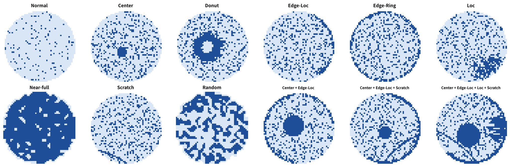
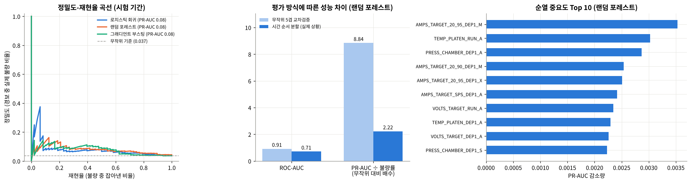
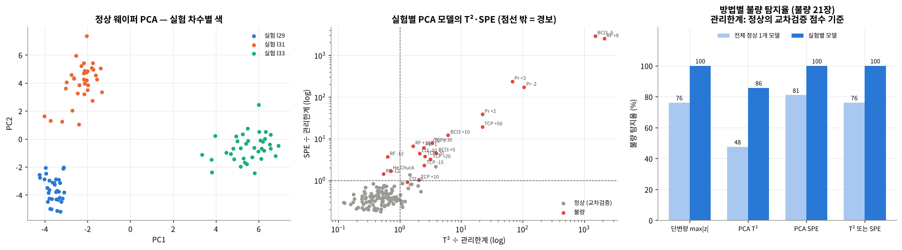

# 반도체 공정 데이터 9종 탐색적 분석 & 모델링

반도체 공정에서 나오는 **형식이 서로 다른 공개 데이터 9종**을 직접 읽고, 데이터 품질 문제를 진단하고, 공정에서 의미 있는 패턴을 시각화했습니다. 그중 2종은 **불량 예측 모델**과 **이상 탐지 모델**까지 만들었습니다.

- 작성: 김태영
- 사용 기술: Python · pandas · NumPy · matplotlib · scikit-learn
- 전체 보고서: [`report/index.html`](report/index.html) (브라우저로 열기)



---

## 핵심 결과

### 모델 A — AlCu PVD 웨이퍼 불량 예측
공정 변수 134개로 측정 전에 불량 웨이퍼를 골라낼 수 있는지 확인했습니다.

| 평가 방식 | ROC-AUC | PR-AUC (무작위 대비) |
|---|---|---|
| 무작위 5겹 교차검증 | 0.91 | 8.8배 |
| **시간 순서 분할 (실제 상황)** | **0.71** | **2.2배** |

- 위험 점수 상위 10% 웨이퍼만 검사해도 불량의 **25%**를 잡습니다(무작위 검사의 2.5배).
- 같은 모델이라도 **무작위 분할로 평가하면 성능이 크게 부풀려집니다.** 시기별로 데이터 분포가 달라지기 때문에, 시간 순서 분할로 평가했습니다.
- 측정 결과 열(`RAW_VALUE_*`, 두께·저항 평균)은 입력에서 빼서 **데이터 누수를 막았습니다.**



### 모델 B — LAM 9600 식각 불량 이상 탐지
정상 웨이퍼만 학습해서, 처음 보는 불량 21건을 찾을 수 있는지 확인했습니다.

| 방법 (실험 차수별 기준선) | 오경보율 | 탐지율 |
|---|---|---|
| 단변량 max\|z\| | 9.3% | 100% |
| PCA T² | 21.5% | 86% |
| **PCA SPE** | **2.8%** | **100%** |

- 탐색 분석에서 본 군집이 **실험 차수 3개**와 일치했습니다. 실험별로 기준선을 따로 잡자 SPE 탐지율이 81%에서 100%로 올랐습니다.
- 관리한계를 학습 데이터로 정하면 오경보가 90%를 넘었습니다. 그래서 **교차검증 바깥(out-of-fold) 점수**로 관리한계를 정했습니다.
- 한계: 불량 표본이 21장뿐이므로 실제 성능은 이보다 낮을 수 있습니다.



---

## 데이터 9종과 분석 내용

| # | 데이터 형태 | 데이터셋 | 다룬 내용 |
|---|---|---|---|
| 1 | 웨이퍼 단위 요약표 | Infineon AlCu PVD (APC/SPC) | 두께 추이, 장비별 불량률, 누수 변수 판별 → 모델 A |
| 2 | 센서 시계열 | LAM 9600 Metal Etch | 정상 분위수 띠, 웨이퍼 요약 특징 PCA → 모델 B |
| 3 | 위치별 계측 | Fraunhofer ENAS Bosch Etch | 웨이퍼 맵, 중심·가장자리 차이, 로트 내 드리프트 |
| 4 | 스펙트럼·깊이 프로파일 | ORNL ToF-SIMS WOx | ¹⁸O 비율 깊이 프로파일, 층 구조, 질량 스펙트럼 |
| 5 | 웨이퍼맵 | MixedWM38 | 다중 라벨 결함 패턴 8종 + 혼합 조합 |
| 6 | SEM 이미지 | Infineon Carinthia | 클래스 불균형(약 1,000:1), 라벨별 외관 |
| 7 | 초분광 큐브 | HSI 4H-SiC | ENVI 형식 직접 파싱, 3개 파장 영역 반사율 |
| 8 | 원자 구조 | SAIT MLFF (HfO·SiN) | Train vs OOD 에너지 분포 이동, 3D 원자 배치 |
| 9 | LLM 추출 문헌 데이터 | ALD 공정 파라미터 DB | 두 LLM 추출값 일치율, 불일치 원인(표기 차이) |

데이터별 상세 결과와 그림은 [보고서](report/index.html)에 정리했습니다.

## 분석에서 신경 쓴 점

- **다양한 형식 직접 읽기:** `;` 구분자와 BOM, `#` 메타데이터 머리말, 압축 파일 안의 압축 파일, ENVI 이진 큐브, 확장 XYZ, NPZ
- **데이터 품질 진단:** 기록이 3시점뿐인 웨이퍼, 결측 157건, 문서에 없는 픽셀 값, 잘못 묶인 그룹 키를 찾아 처리
- **과대평가 방지:** 데이터 누수 차단, 시간 순서 분할, 중첩 교차검증
- **확인하지 못한 것은 추정으로 표시:** SEM 라벨 의미, 간섭 피크 해석 등

---

## 폴더 구성

```
semiconductor-data-eda/
├── README.md
├── requirements.txt
├── src/
│   ├── semi_eda.py        # 탐색적 분석 그림 9개
│   └── semi_models.py     # 모델 A·B
├── figures/               # 생성된 그림 (fig1~9, figA, figB)
├── results/               # 수치 결과 (JSON)
├── report/index.html      # 전체 보고서
└── data/README.md         # 데이터 받는 방법 (원본 데이터는 포함하지 않음)
```

## 실행 방법

```bash
pip install -r requirements.txt
# data/ 폴더에 데이터를 넣은 뒤 (data/README.md 참고)
python src/semi_eda.py    data figures
python src/semi_models.py data figures
```

- 난수 시드는 42로 고정했습니다.
- 확인한 환경: Python 3.13, pandas 3.0, scikit-learn 1.9
- 그림의 한글은 Noto Sans CJK KR, 맑은 고딕, AppleGothic, 나눔고딕 중 설치된 글꼴을 자동으로 씁니다.

## 데이터 출처와 라이선스

원본 데이터는 각 배포처의 라이선스를 따릅니다. 재배포 조건이 데이터셋마다 달라서 이 저장소에는 넣지 않았습니다. 출처는 [`data/README.md`](data/README.md)에 정리했습니다. SAIT MLFF 데이터는 CC BY-NC-SA 4.0(비상업 이용) 조건입니다.

코드와 그림의 저작권은 작성자에게 있습니다.
